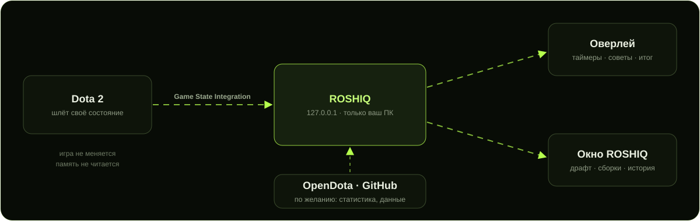

  

  
  
  
  

  <b>Локальный помощник для Dota 2.</b> Подсказывает в драфте, во время игры и после матча — и играет честно: 
  только официальный Game State Integration от Valve, без чтения памяти, без внедрения в игру и без автонажатий.

  

---

## Что умеет

<table>
  <tr>
    <td width="33%" valign="top">
      <h3>🎯 Драфт</h3>
      Контрпики и синергии под вашу роль с объяснением «почему». Учитывает ваш пул героев и статистику OpenDota.
      В режиме тренировки — распознавание пиков прямо с экрана.
    </td>
    <td width="33%" valign="top">
      <h3>🛠️ Сборки</h3>
      Предметы по фазам игры для героя и роли, актуальная мета по популярности у игроков, личные сборки
      и тайминги ключевых предметов.
    </td>
    <td width="33%" valign="top">
      <h3>🕹️ Оверлей в игре</h3>
      Прозрачная панель поверх Dota: руны, лотосы, Рошан, «нет ТП», выкуп, тайник, советы на линию и пики силы.
      Мышь проходит сквозь неё в игру.
    </td>
  </tr>
  <tr>
    <td width="33%" valign="top">
      <h3>📊 После матча</h3>
      Итог сразу после игры: что получилось и одна главная ошибка. Подробный разбор через OpenDota
      и сравнение с другими игроками на этом герое.
    </td>
    <td width="33%" valign="top">
      <h3>🧠 Личный тренер</h3>
      История матчей, цели на игру, закономерности: когда вы чаще выигрываете и что мешает. Привязка Steam
      без пароля.
    </td>
    <td width="33%" valign="top">
      <h3>⚙️ Само работает</h3>
      Прячется при запуске Dota, сам определяет роль, обновляет данные после патча без переустановки,
      а если что-то не так — диагностика с кнопкой «Исправить».
    </td>
  </tr>
</table>

## Как это работает

  

Dota 2 сама отправляет ROSHIQ время матча, героя, золото и инвентарь через **Game State Integration** — официальный механизм Valve,
который используют стримерские оверлеи и подсветка клавиатур. Данные идут только на ваш компьютер (127.0.0.1).
Интернет нужен лишь для статистики и обновлений, и его можно выключить одной галочкой.

<table>
  <tr>
    <td valign="top" width="50%">
      <h4>✅ Что делает ROSHIQ</h4>
      <ul>
        <li>получает данные, которые Dota 2 отправляет сама;</li>
        <li>показывает подсказки поверх игры и в своём окне;</li>
        <li>по желанию берёт публичную статистику с OpenDota;</li>
        <li>хранит историю и настройки у вас на компьютере.</li>
      </ul>
    </td>
    <td valign="top" width="50%">
      <h4>🚫 Чего ROSHIQ не делает</h4>
      <ul>
        <li>не читает память игры и не внедряет код;</li>
        <li>не нажимает клавиши, не покупает и не управляет героем;</li>
        <li>не использует скрытую от вас информацию;</li>
        <li>не просит пароль Steam.</li>
      </ul>
    </td>
  </tr>
</table>

## Быстрый старт

1. **Скачайте** `Roshiq-Setup-<версия>.exe` в [Releases](https://github.com/baramobatare-rgb/ROSHIQ/releases/latest) и запустите.
   Права администратора и .NET не нужны — всё внутри.
2. **Пройдите мастер настройки** при первом запуске: язык, роль, связь с игрой (одна кнопка), Steam и режим подсказок.
3. **Перезапустите Dota 2** и играйте. Оверлей: `F8` — показать/скрыть, `Ctrl+F8` — подробнее, `Ctrl+K` в окне — поиск по программе.

> Если Windows покажет «Windows защитила ваш компьютер» — «Подробнее» → «Выполнить в любом случае»: у программы пока нет платной цифровой подписи.
>
> Без установки: `Roshiq-Portable-<версия>.zip` — распакуйте и запустите `Roshiq.exe`.
>
> Проверить файл: `Get-FileHash <файл> -Algorithm SHA256` и сравнить с `SHA256SUMS.txt` в релизе.

## Частые вопросы

<b>За это не забанят?</b>

 
ROSHIQ использует только Game State Integration — официальный способ, которым Valve разрешает программам получать данные из Dota 2.
Программа не трогает файлы игры (кроме файла настройки GSI в папке <code>cfg</code>), не читает память и ничего не нажимает.
При этом ROSHIQ — неофициальный проект и не одобрен Valve.

<b>Данные из игры не приходят</b>

 
Откройте <b>Настройки → Диагностика</b> (или правый клик по значку в трее). Она проверит файл связи с игрой, порт, параметр запуска
<code>-gamestateintegration</code> и покажет кнопку «Исправить» рядом с проблемой.

<b>Оверлей не виден поверх игры</b>

 
Включите в Dota 2 «Окно без рамки» (Настройки → Видео). В эксклюзивном полноэкранном режиме прозрачные окна поверх игры не отображаются.

<b>Нужен ли интернет?</b>

 
Нет. Без интернета работают драфт по правилам, сборки, таймеры, подсказки и итог матча. Интернет добавляет статистику OpenDota,
мету, разбор матчей и обновления. Все обращения перечислены в <a href="docs/DEVELOPMENT.md#все-сетевые-обращения">документации</a>
и видны в самой программе.

<b>Это бесплатно?</b>

 
Да: всё, что описано на этой странице, бесплатно.

## Версия 0.17.7 — быстрее и удобнее история

- **Главная не нагружает игру:** раньше на каждый сигнал GSI она заново разбирала всю историю матчей. Теперь — только когда история
  изменилась (в том числе исправлен итог старого матча), сменился язык или наступил новый день.
- **Импорт OpenDota:** одно обновление списка на всю пачку и честный итог — сколько добавлено, у скольких дополнен итог и сколько
  не удалось записать. Записи GSI по-прежнему главнее.
- **История:** один снимок на обновление (раньше выбор матча перечитывал историю ещё три раза), фоновые обновления склеиваются,
  выбранный матч и прокрутка списка сохраняются.
- **Карточки матчей в две строки:** «герой · итог» и «дата · длительность»; «неполная запись» видна сразу, а не только в подсказке.
- **Узкое окно и крупный масштаб:** если места мало, список матчей встаёт над разбором во всю ширину.
- **Клавиатура:** у переключателей, флажков, списков и вкладок видна рамка фокуса при навигации клавишей Tab.
- **Закрытие программы:** очередь несохранённых матчей проходит то же правило, что и повторные попытки, — устаревшая версия
  не перезапишет более полную (профилактика, реальной потери не обнаружено).

Вся история изменений — в [CHANGELOG.md](CHANGELOG.md).

## Для разработчиков

C# 12 · .NET 8 · WPF · xUnit · GitHub Actions · Inno Setup. Сборка — `build.cmd`, тесты — `dotnet test tests\Roshiq.Tests`.
Устройство проекта, данные, сетевые обращения и тесты — в [docs/DEVELOPMENT.md](docs/DEVELOPMENT.md), выпуск версий — в [RELEASING.md](RELEASING.md).

---

ROSHIQ — фанатский проект и не связан с Valve Corporation. Dota 2 и Steam — товарные знаки Valve Corporation. Иконка ROSHIQ — фанатская стилизация, не официальный ассет Valve.
